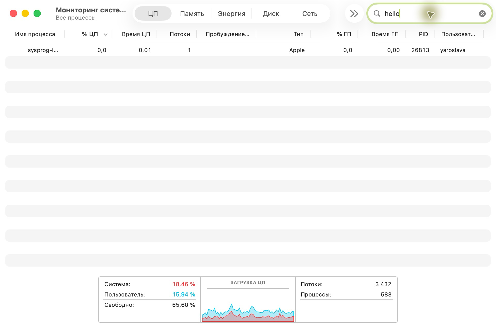
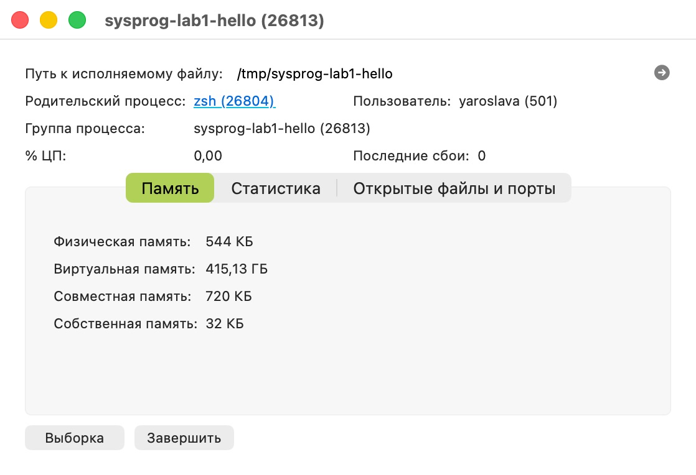
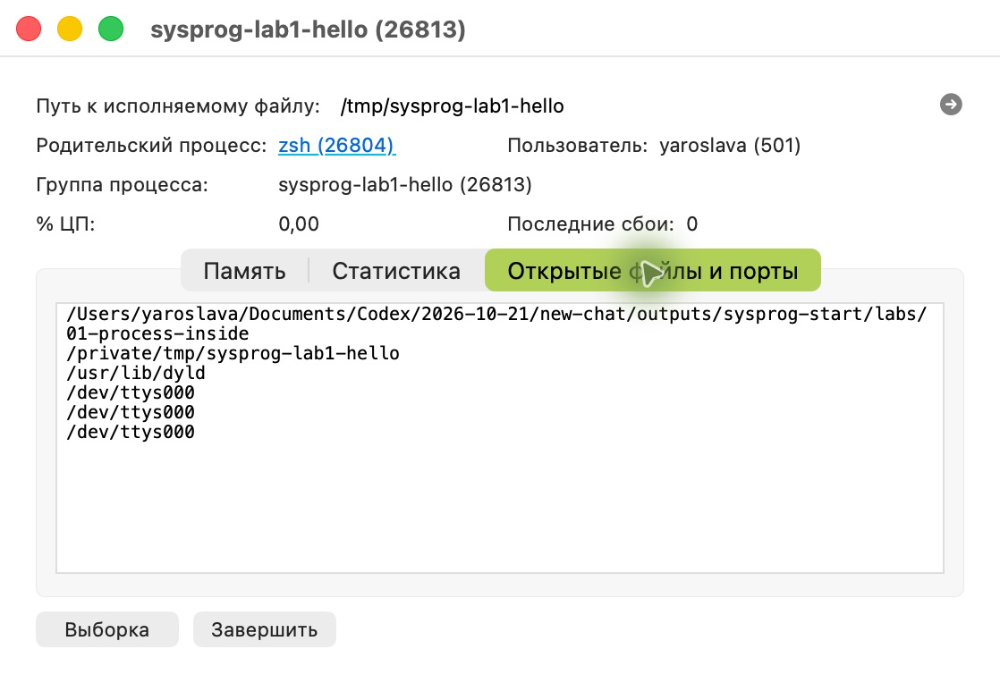
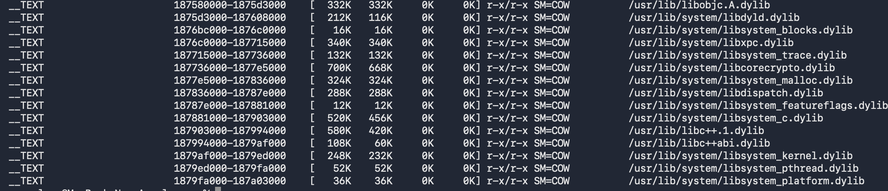
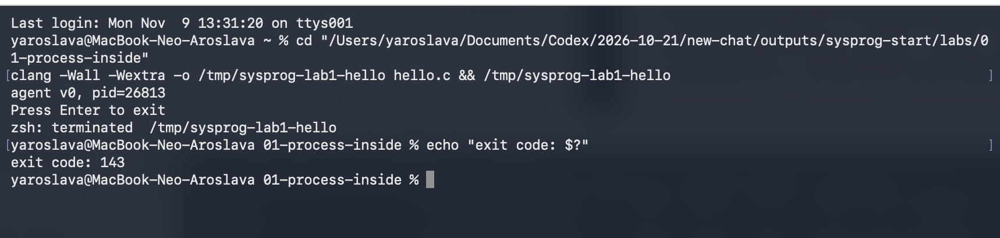
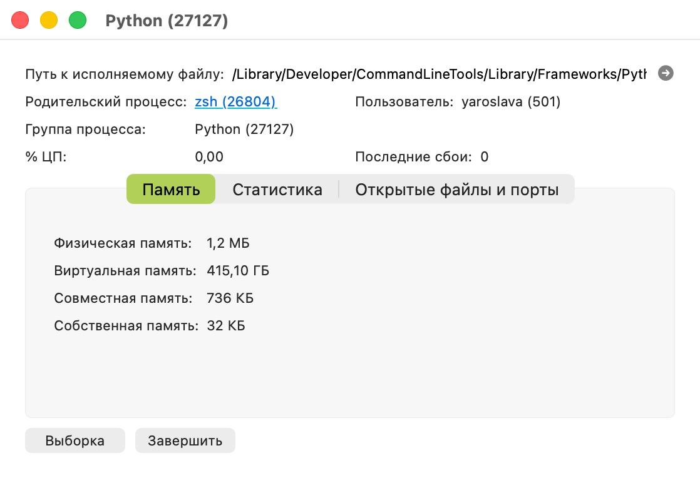
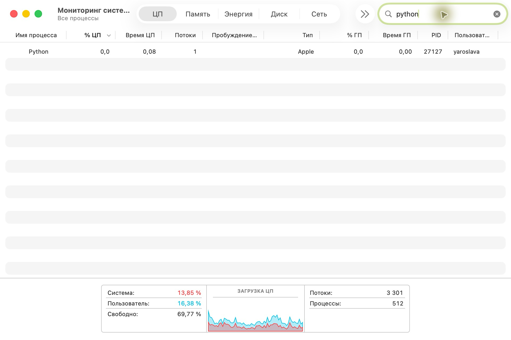
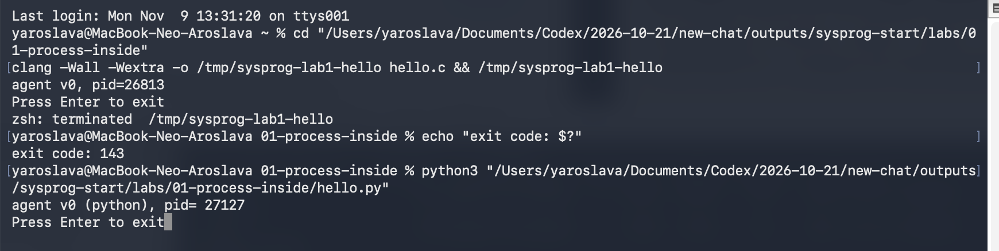
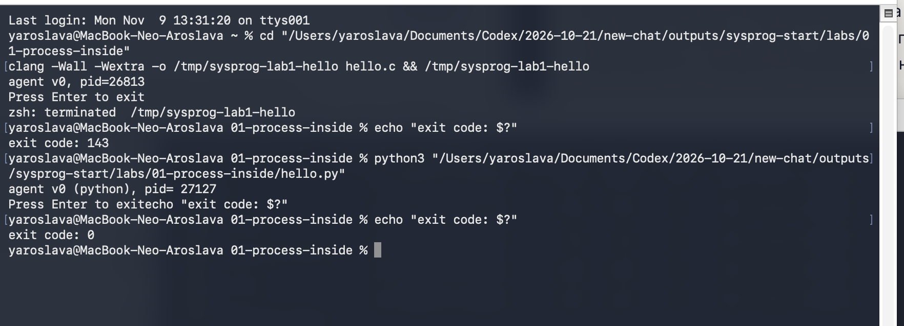

# ЛР 1. Процесс изнутри

Программа на C. PID 26813 совпал в Терминале и Мониторинге системы. Физическая память составила 544 КБ, время ЦП 0,01 с. При ожидании ввода getchar блокируется. Дескрипторы 0, 1 и 2 ведут в /dev/ttys000. В карте памяти 44 файла .dylib, включая libSystem.B.dylib. После завершения из Мониторинга системы код выхода 143 (SIGTERM).

Программа на Python. PID 27127 совпал в обоих окнах. Физическая память составила 1,2 МБ, примерно в 2,2 раза больше. Общая библиотека libSystem.B.dylib. После Enter код выхода 0.

[Открыть PDF](Лабораторная%20работа%201.pdf)

## Снимки

